)

<table>
<tr>
<td width="45%" align="center" valign="middle">

</td>
<td width="55%" valign="middle">

</td>
</tr>
</table>

<h2>🫧 My Contribution Graph</h2>

<picture>
  <source
    media="(prefers-color-scheme: dark)"
    srcset="https://raw.githubusercontent.com/ayu-syaacc/ayu-syaacc/output/pacman-contribution-graph-dark.svg"
  />
  <source
    media="(prefers-color-scheme: light)"
    srcset="https://raw.githubusercontent.com/ayu-syaacc/ayu-syaacc/output/pacman-contribution-graph-light.svg"
  />
  
</picture>
